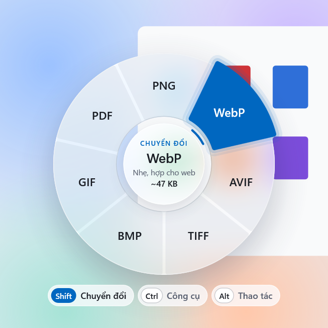
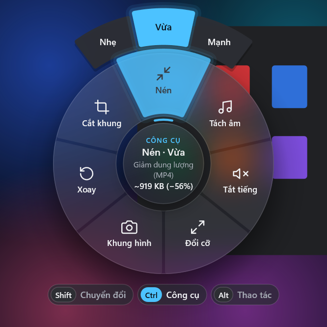
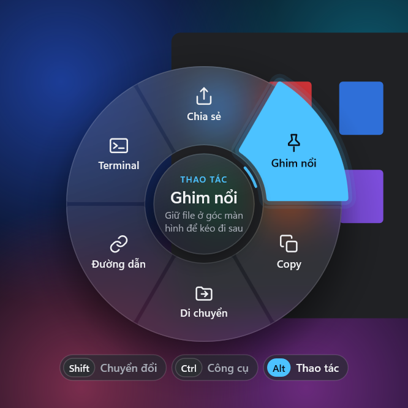
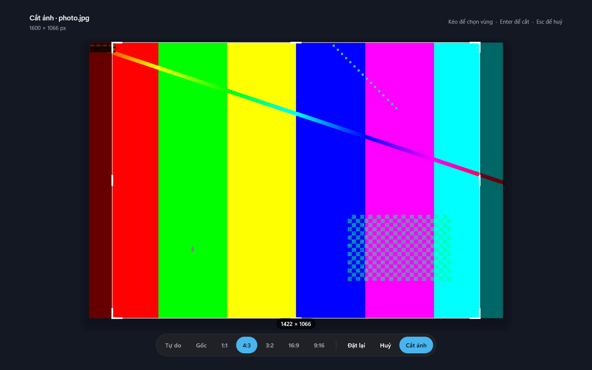

# Vòng Convert

Kéo một file trong Explorer, giữ phím, rồi thả vào vòng tròn để chuyển đổi hoặc xử lý file ngay tại chỗ. Mọi thứ chạy trên máy, không tải file lên đâu cả.

<p>
  
  
  
</p>


## Tải về

Tải `VongConvert-win64.zip` ở mục [Releases](https://github.com/Kiet1308/vong-convert/releases), giải nén rồi chạy `VongConvert.exe`. Cần thêm FFmpeg (xem [Cần có](#cần-có)).

App chưa được ký số, nên lần đầu chạy Windows SmartScreen có thể hiện "Windows protected your PC". Bấm **More info** rồi **Run anyway**.

| Phím (giữ khi đang kéo) | Vòng | Ví dụ |
|---|---|---|
| Shift | Chuyển đổi | PNG → WebP, MOV → MP4, WAV → MP3, SRT → VTT, DOCX → PDF, XLSX → CSV, PDF → ảnh, ảnh → PDF |
| Ctrl | Công cụ | Cắt (mở khung chọn vùng), nén, đổi cỡ, xoay, tách âm, tắt tiếng, giải nén |
| Alt | Thao tác | Chia sẻ, ghim nổi, copy file, copy đường dẫn, di chuyển, mở Terminal |

- Đang mở vòng vẫn đổi phím được.
- Thả vào giữa vòng hoặc bấm Esc để huỷ.
- Ô có vòng ngoài (Nén, Đổi cỡ, Xoay…) thì kéo ra xa để chọn mức. Thả ngay trên ô sẽ dùng mức mặc định.
- **Bàn phím:** chọn file trong Explorer hoặc trên Desktop rồi bấm `Ctrl+Shift+Space`. Dùng ← → để chọn, ↑ để chọn mức, Tab để đổi vòng, Enter để chạy, Esc để đóng.
- **Cắt:** mở màn hình chọn vùng.
  - Kéo góc hoặc cạnh để đổi kích thước, kéo bên trong để di chuyển, kéo ra ngoài khung để vẽ vùng mới.
  - Chọn tỉ lệ có sẵn (1:1, 4:3, 3:2, 16:9, 9:16), hoặc bấm phím số 1–7.
  - Bấm Enter hoặc nhấp đúp để cắt. Với video, app lấy khung hình đầu tiên để chọn vùng.
- **Ghim nổi:** giữ file ở góc trên bên phải màn hình.
  - Kéo thẻ ra để thả file vào bất kỳ app nào.
  - Nhấp đúp để mở, chuột phải để hiện file trong thư mục, ✕ để bỏ ghim.
- **Khi xong việc:** nếu thư mục chứa file đang mở trong Explorer, app chọn sẵn file mới ở đó và bong bóng tiến độ bay vào nó. Nếu không, bấm vào bong bóng hoặc thông báo để mở thư mục.

Cài đặt nằm trong menu chuột phải ở khay hệ thống: phím cho từng vòng, kiểu vòng (kính mờ hoặc đặc), phím tắt bàn phím, tạm dừng, khởi động cùng Windows.

## Cần có

- Windows 10 1903 trở lên (đã thử trên Windows 11).
- **FFmpeg** cho ảnh, video, âm thanh và phụ đề. App tìm `ffmpeg.exe` cạnh `VongConvert.exe`, trong thư mục `tools\`, rồi trong PATH. Có thể cài bằng `winget install Gyan.FFmpeg`.
- **Microsoft Office** (Word, Excel, PowerPoint) cho tài liệu. Không có Office thì app dùng LibreOffice nếu máy có cài. PDF → ảnh dùng bộ đọc PDF có sẵn của Windows nên không cần gì thêm.
- **7-Zip** (không bắt buộc) cho 7Z, RAR, TAR và đổi định dạng file nén. Không có 7-Zip thì vẫn nén và giải nén được ZIP. Cài bằng `winget install 7zip.7zip`.

## Build

Dùng MinGW-w64 (GCC 13+) và CMake:

```
cmake -S . -B build -G Ninja -DCMAKE_BUILD_TYPE=Release
cmake --build build
```

Kết quả là một file `build\VongConvert.exe` (khoảng 1 MB), liên kết tĩnh, chỉ dùng DLL có sẵn của Windows.

## Chạy

Mở `VongConvert.exe`. App nằm ở khay hệ thống. Lần chạy đầu tiên, app tự bật khởi động cùng Windows (ghi vào `HKCU\...\Run`). Tắt trong menu khay thì app giữ nguyên lựa chọn đó. Nhật ký nằm ở `%LOCALAPPDATA%\VongConvert\log.txt`.

Lệnh dành cho phát triển:

```
VongConvert.exe --render-test out.png <mode 0|1|2> <file> [item] [sub] [dpi] [theme 0|1]
VongConvert.exe --crop-test <file> out.png [preset 0-6]
VongConvert.exe --job <mode> <item> <sub|-> <file>...
VongConvert.exe --explorer-test <file>
VongConvert.exe --share-test <file>
VongConvert.exe --bench <ảnh>
```

- `--render-test` vẽ vòng tròn ra ảnh PNG.
- `--crop-test` vẽ màn hình cắt ra ảnh PNG.
- `--job` chạy một việc không có giao diện, trả về mã 0 khi thành công. Cắt dùng sub dạng `x:y:w:h`.
- `--explorer-test` chọn file trong một cửa sổ Explorer đang mở thư mục của nó, rồi ghi vị trí và vùng chọn vào nhật ký.
- `--share-test` nạp bộ Chia sẻ của Windows cho file (không mở bảng Chia sẻ).
- `--bench` đo thời gian mở và vẽ của vòng tròn và màn cắt, và bộ nhớ trước/sau, ghi vào nhật ký. Mỗi lần mở vòng thật cũng ghi một dòng `wheel session` (khung hình đầu, nền kính, thời gian vẽ).

## Cấu trúc

| File | Vai trò |
|---|---|
| `src/main.cpp` | Khay hệ thống và cài đặt, hook bàn phím, đồng hồ khung hình theo vsync, điều phối |
| `src/wheel.cpp` | Vòng tròn: nhận kéo-thả (OLE), chế độ bàn phím, chọn ô, hiệu ứng lò xo, vẽ bằng Direct2D |
| `src/crop.cpp` | Màn hình chọn vùng cắt |
| `src/pin.cpp` | Thẻ ghim nổi |
| `src/bubble.cpp` | Bong bóng tiến độ và hiệu ứng bay vào file mới |
| `src/catalog.cpp` | Loại file, danh sách ô của từng vòng, chữ hiển thị, ước lượng dung lượng |
| `src/jobs.cpp` | Chạy FFmpeg, 7-Zip, Office, bộ đọc PDF của Windows; ghi PDF từ ảnh; xử lý phụ đề |
| `src/actions.cpp` | Copy, đường dẫn, Terminal, di chuyển, Chia sẻ; đọc file đang chọn và chọn file trong Explorer |
| `src/gfx.cpp` | Thiết bị Direct3D/Direct2D/DirectComposition, nền kính mờ, màu theo giao diện Windows |
| `src/settings.cpp` | Lưu cài đặt trong `HKCU\Software\VongConvert` |

## Ghi chú kỹ thuật

- Vòng tròn chỉ xuất hiện khi OLE xác nhận đang kéo file. Giữ phím trong lúc chọn chữ hay kéo cửa sổ thì không có gì hiện ra.
- Vẽ trên GPU tích hợp (tiết kiệm điện) qua DirectComposition. Hiệu ứng chạy theo tần số quét của màn hình đang có con trỏ. Khi rảnh, app không tốn CPU.
- Nền kính mờ là ảnh chụp vùng màn hình phía sau, làm mờ một lần lúc mở.
  - Chụp ở luồng phụ, vì GDI phải chờ DWM (~10 ms cho vòng, ~45 ms cho cả màn hình). Lúc chụp, cửa sổ của app được loại khỏi ảnh bằng `WDA_EXCLUDEFROMCAPTURE`.
  - Chụp và làm mờ ở 1/2 (vòng) hoặc 1/4 (màn cắt) độ phân giải. Vòng và màn cắt hiện ngay, nền mờ mịn dần vào sau.
- Khi rảnh: 3 giây sau lần dùng cuối, app dọn cache GPU và trả RAM rảnh cho Windows. Sau 5 phút (và không có thẻ ghim), app huỷ hẳn thiết bị đồ hoạ; lần mở sau dựng lại mất ~50 ms.
- Số đo trên máy phát triển (Intel Graphics, 144 Hz):
  - Vẽ một khung hình vòng tròn: ~1,6 ms CPU+GPU.
  - Vẽ một khung hình màn cắt: ~2,6 ms.
  - Luồng giao diện bị chặn khi mở vòng: ~3 ms.
  - Khi chờ: CPU 0, khoảng 29 MB RAM riêng, 7 MB GPU.
- Cắt ảnh/video: khung xem trước và lệnh cắt cùng do FFmpeg giải mã, nên ảnh xoay theo EXIF và video xoay vẫn khớp đúng điểm ảnh.
- Office được điều khiển qua COM. App chỉ đóng Word/Excel/PowerPoint khi nó không còn file nào khác đang mở. Nếu một lần chuyển đổi bị treo, app dừng nó sau 3 phút và chỉ tắt bản Office không có cửa sổ mà lần đó mở ra.
- Không dùng `tar.exe` của Windows vì nó làm hỏng tên file có dấu tiếng Việt.
- Chưa có PDF → Word: tính năng nhập PDF của Word bị treo khi chạy ngầm.

## Giấy phép

[MIT](LICENSE). FFmpeg, 7-Zip và Microsoft Office không đi kèm; mỗi phần mềm có giấy phép riêng.
